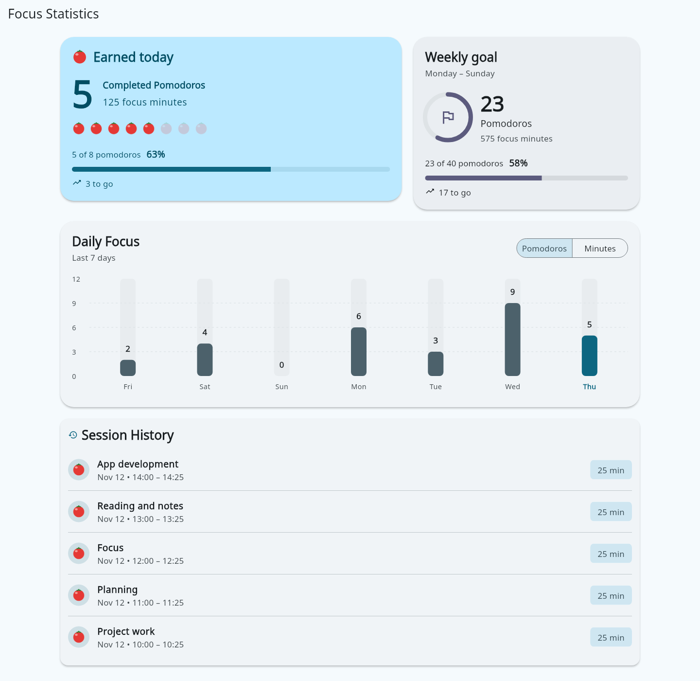
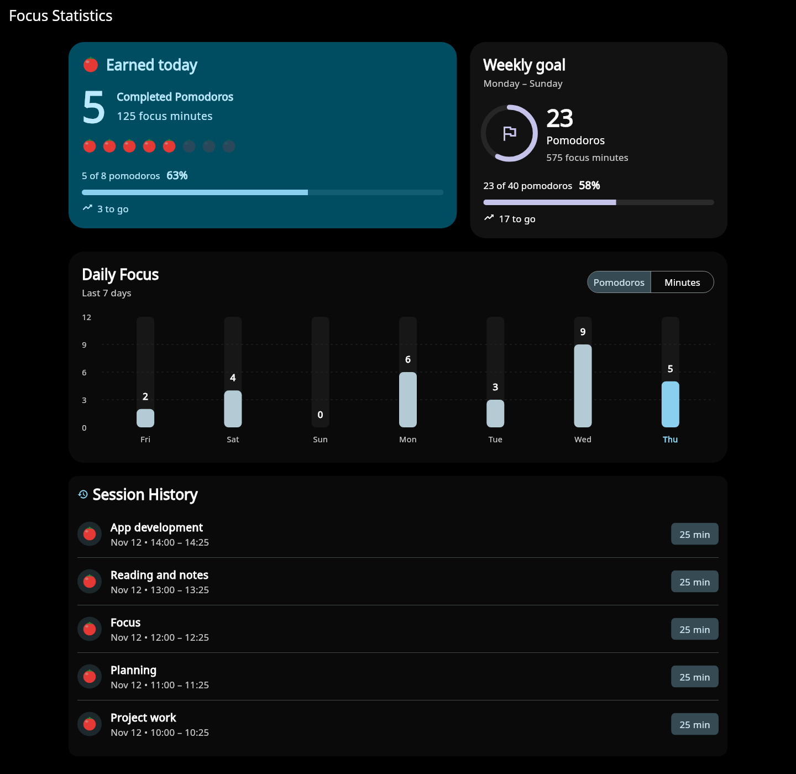

# Pomodoro Focus & World Clock

An offline Pomodoro timer and world clock built with Flutter and Material 3.
The current development target is **Linux, especially KDE Plasma 6 on Wayland**.
Android, Windows, macOS and iOS folders are experimental; development and verification on those platforms are paused.

## Features

- Configurable 25/5/15 minute focus and break intervals, long breaks after four Pomodoros, pause, skip, reset and optional automatic starts.
- Deadline-based timing that catches up after sleep while the app remains running.
- Optional task names, desktop notifications and a bundled bell sound.
- KDE notification inhibition during focus, released on pause, completion and exit.
- Optional screen power off at a break and automatic power on when it ends, using `kscreen-doctor` on KDE Wayland. This does not lock the session; mouse or keyboard input can wake the display earlier.
- World clocks with IANA time zones, daylight saving transitions, search and reordering.
- SQLite session history, daily and weekly goals, progress on the timer screen and a seven-day chart. Only completed focus sessions count. The week runs Monday–Sunday; default goals are 8/day and 40/week, and 0 disables a goal.
- Tray controls, close to tray, a compact always-on-top timer and saved window geometry.
- Light, dark, pure-black OLED and system themes, dynamic colors where supported, an English interface and adjustable text size (100–150%, default 120%).

No analytics or advertising. Timer, clocks and history work offline. Optional automatic update checks (enabled by default) request public GitHub Releases metadata at startup and at most every 12 hours; disable them in Settings to keep the app offline. Packages download only after you press Update. No tasks, history or settings are uploaded.

## Screenshots

These screenshots use **synthetic demonstration data**, not a user's session history.




## Try the Linux release (no Flutter required)

Download the `.deb` from [Releases](https://github.com/SergeyShastin/pomodoro-focus/releases/latest) and open it with your graphical package installer. It installs runtime dependencies and adds the app to your application menu. The package targets **Ubuntu/Kubuntu 26.04 amd64**; Flutter is not needed.

The portable Linux x86_64 archive is also available. See the [installation guide](docs/LINUX_INSTALL.md) for both methods, checksums, migration from a user-local installation and removal. Version 1.1.0 adds optional GitHub Releases checks and a button to download a verified `.deb` and open the system installer. An APT repository is not configured.

## Build on Linux

Tested toolchain: Flutter 3.50.0 stable / Dart 3.14.0. Install Flutter separately and ensure `flutter doctor` reports Linux desktop support.

Ubuntu/Kubuntu build and runtime dependencies:

```bash
sudo apt install build-essential clang cmake ninja-build pkg-config libgtk-3-dev liblzma-dev libayatana-appindicator3-dev libgstreamer1.0-dev libgstreamer-plugins-base1.0-dev gstreamer1.0-plugins-good libsqlite3-0 python3
```

For KDE screen power control install `libkscreen-bin`; for window geometry and always-on-top support in a Wayland session, install `xwayland`.

From the project directory:

```bash
flutter pub get
flutter gen-l10n
flutter analyze
flutter test
flutter run -d linux
```

Create and install a release build for the current user:

```bash
flutter build linux --release
python3 tool/install_linux_app.py --bundle build/linux/x64/release/bundle --autostart
```

Omit `--autostart` if automatic startup is not wanted. The installer needs no sudo: it copies the bundle to `~/.local/opt/pomodoro-focus` and registers the menu entry, icon and optional desktop-session autostart in user XDG directories. Repeating the command updates the installation and keeps a backup of the previous bundle. History and settings remain in the user's application storage. Disable autostart in KDE System Settings → Autostart.

## Linux behavior and limits

In a KDE Wayland session the runner selects the GTK X11 backend through XWayland when `DISPLAY` is available. An explicitly set `GDK_BACKEND` takes priority. Native Wayland window positioning and always-on-top behavior are not guaranteed by the current window plugin.

Closing to tray keeps the timer running. **An unfinished timer is not restored after a full application exit**; completed history and settings are retained. Sleep catch-up requires the process to remain alive. KDE notification inhibition depends on the notification server and its treatment of critical notifications.

Display power control requires KDE Wayland and `kscreen-doctor`. It is optional and disabled by default. Enable automatic break starts for a fully automatic cycle; a break awaiting manual start cannot finish on its own. System power and lock policies still apply.

The cross-platform structure is not a promise of feature parity. In particular, mobile background execution and scheduled alarms are not a verified release feature.

## Tests and project layout

```bash
flutter analyze
flutter test
```

An optional integration test requires an active KDE desktop, D-Bus, XWayland and the `dbus-bin` / `x11-utils` packages:

```bash
flutter test integration_test/linux_features_test.dart -d linux
```

It opens a window, plays sound, sends a real notification and temporarily inhibits notifications. Its database and settings are isolated. Run it in a suitable desktop session; it does not test physical laptop suspend.

Feature code lives in `lib/features/{timer,world_clock,stats,settings}`; shared platform services, storage and themes live in `lib/core`. The timer engine is pure Dart with an injectable clock. Tests cover timer transitions, sleep catch-up, time zones, repositories and widgets.

Generated localization and Drift files are included. After changing database definitions, run `dart run build_runner build --delete-conflicting-outputs`; after changing translations, run `flutter gen-l10n`.

## License

[MIT](LICENSE), including the v1.0.0 release. Dependency licenses remain with their respective authors.
